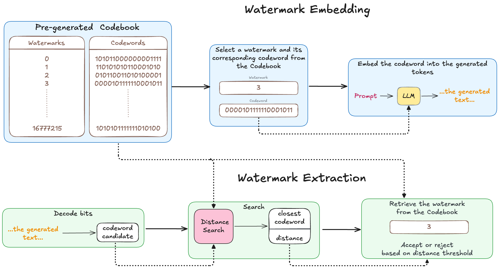

# Look It Up: Multi-bit LLM Watermarking via Codebook Search

Official implementation of the paper **"Look It Up: Multi-bit LLM Watermarking via Codebook Search"** by Jarosław Janas, Paweł Morawiecki, and Josef Pieprzyk (Institute of Computer Science, Polish Academy of Sciences; CSIRO).

**Paper:** preprint; a link will be added here once it is public.

A multi-bit watermark hides a short message, the *payload*, in text while a language model generates it, so that a text found later can be traced to its source, for example to a user or session ID. This repository embeds an `n`-bit payload by biasing the model's choice of each token and recovers it from the text alone, using only the secret key and the model's tokenizer. In most settings a text of 127 tokens is enough.

Instead of decoding the payload bit by bit, the extractor reads one noisy bit per token and looks up the nearest entry in a secret, precomputed table of 2<sup>n</sup> codewords, the *codebook*. Embedding needs access to the model's logits, so the scheme is meant for whoever runs the model.



*In the figure, "watermark" means the payload, an integer from 0 to 2<sup>n</sup> − 1. The codewords are shortened for display.*

## Contents

- [Highlights](#highlights)
- [How it works](#how-it-works)
- [Installation](#installation)
- [Quick start](#quick-start)
- [Command-line reference](#command-line-reference)
- [Output files](#output-files)
- [Python API](#python-api)
- [Analysis scripts](#analysis-scripts)
- [Reproducing the paper](#reproducing-the-paper)
- [Results](#results)
- [Implementation notes](#implementation-notes)
- [Limitations](#limitations)
- [Citation](#citation)
- [Acknowledgements](#acknowledgements)

## Highlights

*Match rate* is the percentage of texts from which the complete payload is recovered.

- **Short texts.** Payloads of 16–24 bits are recovered from 99.8–99.9% of 200-token texts generated by Llama 2 7B; the best prior method reaches 98.0–99.6% in the same setting ([comparison](#comparison-with-prior-work)). At 127 tokens with a 24-bit payload, the two codebook variants reach 97.5–100% on base (not instruction-tuned) models and 61.6–96.3% on instruction-tuned ones.
- **Fast extraction.** A brute-force search over all 2<sup>24</sup> ≈ 16.8M codewords takes 4–76 ms per text, using Faiss on CPU (Hamming) or custom Triton kernels on GPU (Levenshtein).
- **Robustness.** With Levenshtein search, 95.2% of payloads survive the deletion of 10% of the tokens and 98.9% survive paraphrasing of a span of the same size. Word insertion (57.3%) and synonym replacement (76.4%) are weak points.
- **Three variants.** Codebook search with Levenshtein distance (recommended when texts may be edited), codebook search with Hamming distance (the faster codebook search), and a codebook-free variant built on BCH error-correcting codes for larger payloads (on the `bch` branch).

## How it works

The scheme has one offline step and two online steps.

1. **Codebook generation (offline).** Every payload `W`, an integer in `0 … 2^n − 1` that the code also calls the watermark identity, is mapped to a `u`-bit codeword, with `u > n`. The default construction is a random linear code over GF(2) with an affine offset:

   ```
   L_W = bits(W) · G  mod 2  ⊕  r
   ```

   In words: each codeword is the XOR of the rows of a secret random matrix `G` that are selected by the bits of `W`, plus a secret offset `r`. The `n × u` matrix `G` and the `u`-bit offset `r` are derived from the secret key with SHA-256, so the codebook cannot be rebuilt without the key.

2. **Embedding.** The LLM generates up to `u` tokens, one per codeword bit, and stops early only at end-of-sequence. At each step the vocabulary is split into a *green list* and a *red list* (equal halves by default) using a hash of the previous generated token and the secret key, as in [Kirchenbauer et al., 2023](https://arxiv.org/abs/2301.10226). The first token uses a fixed value in place of the previous token, so extraction does not need the prompt. A logit bias `δ` is added to the green list when the current bit is 1 and to the red list when it is 0, and the next token is then chosen greedily by default.

3. **Extraction.** The text is re-tokenized and each token is classified as green (1) or red (0), which reads back a noisy `u`-bit sequence. The codebook is then searched for the nearest codeword, either by Hamming distance (the number of differing bit positions) or by Levenshtein distance (edit distance, which also allows inserted and deleted bits). The search returns the payload and its distance. A threshold on that distance separates watermarked from non-watermarked text; `main.py` reports the nearest match without a threshold, and the analysis scripts apply one.

The redundancy `u − n` is what makes this reliable. With the default secret key and `n = 24`, the linear codebook has a minimum Hamming distance `d` of 35 at `u = 127` and 62 at `u = 200`, so Hamming search always corrects up to ⌊(d − 1)/2⌋ = 17 and 30 flipped bits respectively. Other keys give slightly different values (for example 34 and 61), and the guarantee does not extend to Levenshtein search, where nearest-neighbour distances are smaller and vary between codewords. The probability that any two payloads share a codeword is at most 2<sup>2n−u−1</sup>, which is 2<sup>−80</sup> at `n = 24`, `u = 127`.

### Variants

| Variant | How to run it | Best for | Trade-off |
|---|---|---|---|
| Codebook + Levenshtein (recommended when texts may be edited) | `--distance levenshtein-triton` (GPU) or `--distance levenshtein` (CPU) | Robustness to word deletion and light paraphrasing | Slower search; lower match rate than Hamming on unmodified text from instruction-tuned models; word insertion remains hard |
| Codebook + Hamming | `--distance hamming` (the default) | Speed and the highest match rate on unmodified text | One inserted or deleted token shifts every later bit |
| BCH, no codebook | [`bch` branch](https://github.com/jaroslawjanas/llmw-codebook/tree/bch) | Payloads too large for a codebook (e.g. 32 bits) | Lower accuracy and robustness, especially on instruction-tuned models |

> **Note on BCH.** BCH (Bose–Chaudhuri–Hocquenghem) codes are classical error-correcting codes. On `master`, `--codeword-generation bch` fills the *codebook* with BCH codewords and still extracts by nearest-neighbour search. The codebook-free BCH variant evaluated in the paper (algebraic decoding with code shortening) is implemented on the `bch` branch.

## Installation

You need [conda](https://docs.conda.io/) and, for anything beyond small smoke tests, an NVIDIA GPU with CUDA.

1. Clone the repository:

   ```bash
   git clone https://github.com/jaroslawjanas/llmw-codebook.git
   cd llmw-codebook
   ```

2. Check two things in `environment.yml` **before** creating the environment:

   - **PyTorch / CUDA.** The file pins PyTorch 2.5.1 with CUDA 12.4. If your GPU needs a different build, comment those two lines out and install PyTorch from [pytorch.org](https://pytorch.org/get-started/locally/) after step 3.
   - **Triton.** The file enables the Linux package (`triton`). On Windows, comment that line out and uncomment `triton-windows`. [Triton](https://github.com/triton-lang/triton) is imported at start-up, so it must be installed even if you only use Hamming distance.

3. Create and activate the environment:

   ```bash
   conda env create -f environment.yml
   conda activate llmw-codebook
   ```

On Linux, if Triton later reports a missing `libcuda.so`, create a symlink next to the existing library: `ln -s libcuda.so.1 libcuda.so`.

**Hugging Face token.** The smoke test below does not need one. Gated models such as Llama require you to request access on the model page and to supply an access token: create a file named `hf_token` in the repository root that contains the token and nothing else. The whole file is read as the token, so do not simply rename `hf_token.template`, which also contains comment lines. The file is gitignored.

Run all commands from the repository root: `hf_token`, `./cache`, and `./output` are resolved relative to the working directory. Multi-line commands below use the bash line continuation `\`; in PowerShell, put the command on one line or use a backtick instead.

## Quick start

A smoke test with a small public model. It downloads `facebook/opt-125m` and the default prompt dataset, builds a 2<sup>16</sup>-entry codebook, and watermarks five prompts:

```bash
python main.py --model facebook/opt-125m --n 16 --u 127 --n-prompts 5 --verbose
```

The run ends with a summary such as `Made 5 successful watermark recoveries out of 5` and writes its results to a new directory under `output/` (see [Output files](#output-files)). Texts that end before 127 tokens are not scored, so the total can be lower than 5.

A setting from the paper: 24-bit payload, 200 tokens, Llama 2 7B on the OpenGen prompts, Levenshtein search on GPU (`--context-window 5000` matches the paper's runs):

```bash
python main.py \
  --model meta-llama/Llama-2-7b-hf \
  --dataset jaroslawjanas/open-generation-data default train prefix \
  --n 24 --u 200 \
  --distance levenshtein-triton \
  --n-prompts 100 --context-window 5000
```

A single custom prompt:

```bash
python main.py --model mistralai/Mistral-7B-Instruct-v0.1 --n 20 --u 127 \
  --prompt "Write a short review of a budget mechanical keyboard." --verbose
```

The first run with a new `(n, u, secret key, generator)` combination builds the codebook and caches it under `cache/codebooks/`. Each prompt is assigned a pseudo-random payload derived from `--seed`. `main.py` only extracts from the texts it has just generated; to embed a specific payload or to extract from your own text, use the [Python API](#python-api).

## Command-line reference

`main.py` generates watermarked text, extracts the payload from each text, and reports the match rate.

### Watermark

| Flag | Default | Description |
|---|---|---|
| `--n` | `16` | Payload size in bits. The codebook holds 2<sup>n</sup> payloads. |
| `--u` | `100` | Codeword length in bits, which is also the number of tokens generated. |
| `--bias` | `6.0` | Logit bias `δ` added to the favoured list. `0` disables the watermark. |
| `--green-fraction` | `0.5` | Fraction of the vocabulary in the green list. |
| `--secret-key` | `25111915` | Key for the vocabulary split and the codebook. The default is public: change it for any real use, and see [Codebook storage](#codebook-storage) for where the key is written. |
| `--codeword-generation` | `linear` | Codebook construction: `linear` (random linear code), `rng` (independent random codewords), or `bch` (BCH codewords stored in the codebook; not the paper's BCH variant, see the [note on BCH](#variants)). |
| `--bch-m` | auto | BCH field degree `m`, from 3 to 9. The native length 2<sup>m</sup> − 1 must be at least `u`. Only used with `bch`. |
| `--distance` | `hamming` | Search metric and backend: `hamming` (Faiss, CPU), `levenshtein` (Numba, CPU), or `levenshtein-triton` (Triton, GPU). |
| `--skip-ti-correction` | off | Disable the tokenization-inconsistency (TI) correction during generation. With `--distance hamming`, a text that then re-tokenizes to fewer than `u` tokens aborts the run, so combine this flag with `--bypass-tokenization` or a Levenshtein distance. |
| `--bypass-tokenization` | off | Read the bits from the generated token IDs instead of re-tokenizing the text. |

### Model and sampling

| Flag | Default | Description |
|---|---|---|
| `--model` | `facebook/opt-125m` | Hugging Face model ID. The model's chat template is applied when it has one; otherwise the raw prompt is used. |
| `--temperature`, `--temp` | `0.0` | Sampling temperature. `0` means greedy selection. |
| `--top-p` | `1.0` | Nucleus sampling threshold. `1.0` disables it. Ignored when the temperature is 0. |
| `--context-window` | `1500` | Maximum number of context tokens kept during generation. |
| `--no-cuda` | off | Generate and read back bits on CPU. `levenshtein-triton` still requires a CUDA GPU. |

### Prompts

| Flag | Default | Description |
|---|---|---|
| `--prompt` | none | A single custom prompt. Overrides `--dataset` and `--n-prompts`. |
| `--dataset` | Essays-With-Instructions | One argument: a local `.json` file (array of strings) or `.txt` file (one prompt per line). Four arguments: a Hugging Face dataset as `<name> <subset> <split> <column>`. |
| `--n-prompts` | `1` | Number of prompts, or `all`. |
| `--seed` | `42` | Seed for prompt shuffling and payload selection. Sampling at a temperature above 0 is reproducible only with `--synch`. |

### Performance

| Flag | Default | Description |
|---|---|---|
| `--num-gpus` | `0` | GPUs to use. `0` uses all of them, with one generation process per GPU. |
| `--dedicated-search-gpu` | off | Reserve the last GPU for codebook search and generate on the others. Needs `levenshtein-triton` and at least 2 GPUs. |
| `--delayed-search` | off | Generate everything first, then search on all GPUs in parallel. Needs `levenshtein-triton` and at least 1 GPU. |
| `--synch` | off | Run in a single process, without worker processes. Useful for debugging. |
| `--workers` | `4` | Processes for codebook generation (`rng` and `bch`). |
| `--chunk-rows` | auto | Rows per chunk during codebook generation. |
| `--cache-dir` | `./cache` | Location for codebooks, datasets and the extractor's tokenizer. The generation processes load the model from `./cache/models` regardless, unless `--synch` is set. |
| `--verbose` | off | Print per-prompt details. |

`--dedicated-search-gpu` and `--delayed-search` are mutually exclusive, and neither can be combined with `--synch`.

`--stats` and `--hash-window` are accepted but currently have no effect; the vocabulary split always hashes the single previous token.

## Output files

Each run writes a directory under `output/`:

```
output/<model>_<dataset>_n<n>_u<u>_c-<generator>_<distance>_<timestamp>/
├── config.json       the main parameters, plus a SHA-256 hash of the codebook
├── results.txt       match rate, bit accuracy, TI corrections, timings
├── generations.csv   one row per scored text (see below)
└── generations.txt   prompts and generated texts in readable form
```

The `<dataset>` part is empty with `--prompt` and is the file's base name for a local file.

`generations.csv` has the columns `prompt_text`, `codeword`, `watermark`, `decoded_codeword`, `retrieved_watermark`, `successful_watermark`, `distance`, `generated_token_ids`, `decoded_token_ids`, and `generated_text`. Here `watermark` is the embedded payload and `retrieved_watermark` the extracted one.

Only texts that reach the full `u` tokens are scored. A text that hits end-of-sequence early is counted in "total prompts processed" but is excluded from the match rate and appears in neither `generations.csv` nor `generations.txt`.

## Python API

The classes can be used directly, for example to embed a chosen payload:

```python
from src.codebooks import CodebookBase, CodebookHamming, LinearCodeGenerator
from src.llm_watermark import LLMWatermarkEncoder, LLMWatermarkDecoder

MODEL, KEY, N, U = "facebook/opt-125m", "my-secret", 16, 127

# Offline: build (or load from cache) the codebook and its search index
base = CodebookBase(n=N, u=U, secret_key=KEY, generator_cls=LinearCodeGenerator)
codebook = CodebookHamming(base)

# Embed identity 12345
watermark = 12345
codeword = base.get_codeword_by_index(watermark).tolist()
encoder = LLMWatermarkEncoder(MODEL, secret_key=KEY, n=N, u=U, device="cpu")
prompt = "The history of the bicycle begins in the early nineteenth century, when"
_, text, *_ = encoder.generate_text(prompt, codeword)

# Extract it again from the text alone
decoder = LLMWatermarkDecoder(MODEL, secret_key=KEY, n=N, u=U, device="cpu")
bits, _, _ = decoder.decode(text)
assert len(bits) == U, "generation ended before u tokens"
_, recovered, distance = codebook.find_closest_match(bits)
print(recovered == watermark, distance)   # True, with a small distance
```

`generate_text` returns `(full_text, generated_text, token_ids, formatted_prompt, statistics)`, `decode` returns `(bits, token_count, token_ids)`, and `find_closest_match` returns `(codeword, payload, distance)`.

Details to keep in mind:

- Generation stops at end-of-sequence, so a text can come out shorter than `u` tokens.
- `opt-125m` is a base language model without a chat template: give it a text to continue, as above, rather than an instruction.
- `CodebookHamming.find_closest_match` needs exactly `u` bits. `CodebookLevenshtein` and `CodebookLevenshteinTriton` accept shorter or longer sequences, but `decode` keeps only the first `u` tokens unless it is called with `truncate=False`.
- Use the same device type (`"cpu"` or `"cuda"`) for the encoder and the decoder. See [Encoder and decoder must use the same device type](#encoder-and-decoder-must-use-the-same-device-type).
- To decide whether a text is watermarked at all, compare `distance` with a threshold for your `(n, u, metric)`. `scripts/matchrate_at_fpr.py` reports the threshold for a target false-positive rate.

## Analysis scripts

All scripts are run from the repository root, for example `python scripts/auroc.py --help`. Most of them read one or more run directories produced by `main.py` and write their own results under `output/`.

Two naming points: the scripts call the generator flag `--codebook-generation`, whereas `main.py` calls it `--codeword-generation`; and `--z` is a sample count, namely the number of random bit sequences used as non-watermarked negatives, or the number of queries or sampled codewords in the benchmark and spread scripts.

| Script | Purpose |
|---|---|
| `re_search.py` | Re-run the codebook search on an existing run with a different distance metric, without regenerating text. Verifies the codebook hash first. Writes a new run directory that holds search results only, with no generated text. |
| `matchrate_at_fpr.py` | Match rate at a target false-positive rate (FPR). Picks the distance threshold whose FPR on random bit sequences is closest to the target, then scores every run under `--output-root` that matches `n`, `u`, the metric and the generator, pooled per model. |
| `auroc.py` | ROC curve and AUROC for one run: successfully recovered texts against random bit sequences. |
| `combine_auroc.py` | Overlay several ROC curves in one plot. |
| `attack_robustness.py` | Match rate under word deletion, word insertion, synonym replacement, and LLM paraphrasing at a given attack budget. Paraphrasing is on by default and needs an API. |
| `compare_robustness.py` | Bar chart comparing attack results with Qu et al., Yoo et al., and Cohen et al. The baseline values are fixed to the paper's setting (20 bits, 200 tokens, 10% budget). |
| `codebook_spread.py` | Nearest-neighbour distance statistics of a codebook. |
| `spread_vs_n.py` | The same statistics swept over `n`, as a table and a plot. |
| `benchmark_search.py` | Codebook search time per query. |
| `benchmark_tokenizer.py` | Overhead of the TI correction. |
| `perplexity.py` | Token-level perplexity of human, non-watermarked, and watermarked text under an evaluator model. Multi-GPU. |
| `perplexity_boxplot.py` | Box plot of the perplexity results. |
| `diversity.py` | Distinct-1, Distinct-2, and trigram repetition rate. CPU only. |
| `llm_judge.py` | Pairwise LLM-as-a-judge comparison of watermarked and non-watermarked text, using an OpenAI-compatible API or a local model. The rubric is fixed to how believable a text is as a human-written product review or social media post, and the two runs are paired by identical prompt. |

**API access.** The paraphrasing attack and the API judge call an OpenAI-compatible endpoint.

- The attack needs `--api-base-url`, `--paraphrase-model` and a key (`--api-key` or the `OPENROUTER_API_KEY` environment variable). To run without paraphrasing, pass `--attacks deletion insertion synonym`.
- The judge takes its key from `--api-key`, `OPENROUTER_API_KEY` or `OPENAI_API_KEY`, and uses the OpenAI endpoint unless `--api-base-url` is given.
- Failed judge calls are counted as ties and skipped paraphrase calls as misses, so check the `Errors` line and the `Skipped` column in the respective `results.txt`.

The insertion and synonym attacks download NLTK data into `cache/nltk/` on first use.

## Reproducing the paper

The commands below regenerate each result. `<run>` stands for a run directory created by `main.py`. The sample counts for timing (10,000 queries) and spread (50,000 codewords) are the paper's; other `--z` and `--n-prompts` values are examples.

**Match rate on 200 tokens (comparison with prior work).** Llama 2 7B on OpenGen, with `--n` set to 16, 20 and 24. Generate once with Hamming search, then reuse the same texts for Levenshtein:

```bash
python main.py --model meta-llama/Llama-2-7b-hf \
  --dataset jaroslawjanas/open-generation-data default train prefix \
  --n 24 --u 200 --n-prompts all --context-window 5000 --distance hamming

python scripts/re_search.py output/<run> --distance levenshtein-triton
```

**Match rate at FPR ≤ 1% across models.** Run `main.py` with `--n 24` and with `--u 127` or `--u 200` for each of the six models, on the default Essays-With-Instructions dataset and on HC3 (`--dataset Hello-SimpleAI/HC3 <subset> <split> <column>`; the arguments used for the paper are not recorded in this repository).

`matchrate_at_fpr.py` pools every run directly under `--output-root` that matches `--n`, `--u`, the metric and the generator, whatever its dataset or bias. `main.py` always writes to `output/`, so move the runs for this table into a folder of their own first, then run the script once per table column:

```bash
python scripts/matchrate_at_fpr.py --n 24 --u 127 --z 10000 --distance hamming \
  --fpr-target 0.01 --output-root output/fpr_table
```

Repeat with `--u 200` and with `--distance levenshtein-triton`. Levenshtein runs can come from `main.py` or from `re_search.py`.

**AUROC.** `auroc.py` takes one run per call and uses that run's metric, so call it on the Hamming run and on the Levenshtein run (or its `re_search.py` copy):

```bash
python scripts/auroc.py --input-dir output/<hamming-run> --z 50000
python scripts/auroc.py --input-dir output/<levenshtein-run> --z 50000
python scripts/combine_auroc.py \
  --input-dir "output/auroc_*_hamming_*" --label Hamming \
  --input-dir "output/auroc_*_levenshtein*" --label Levenshtein
```

The BCH curve comes from `scripts/auroc_bch.py` on the `bch` branch; add `--input-dir "output/auroc_bch_*" --label BCH` to include it.

**Attack robustness.** `n = 20`, `u = 200`, Llama 2 7B on OpenGen, 10% budget. `<run>` must be the original `main.py` run, not a `re_search.py` copy, because the attacks need the generated text; `--distance` selects the metric used after the attack. The paper's paraphraser is GPT-oss-120B, and the API key is read from `--api-key` or `OPENROUTER_API_KEY`.

```bash
python scripts/attack_robustness.py --input-dir output/<run> --attack-budget 0.1 \
  --distance levenshtein-triton \
  --api-base-url https://openrouter.ai/api/v1 --paraphrase-model <model>

python scripts/compare_robustness.py --input-dir output/word_attack_n20_u200_budget-0p1_<timestamp>
```

**Extraction time.** Repeat both with `--u 200`:

```bash
python scripts/benchmark_search.py --n 24 --u 127 --z 10000 --distance levenshtein-triton
python scripts/benchmark_search.py --n 24 --u 127 --z 10000 --distance hamming --faiss-threads 8
```

**Codebook spread (linear vs. RNG).** Repeat with `--u 200` and with `--distance levenshtein-triton`:

```bash
python scripts/spread_vs_n.py --n 24 --u 127 --z 50000 --distance hamming
python scripts/spread_vs_n.py --n 24 --u 127 --z 50000 --distance hamming --codebook-generation rng
```

**Tokenization-inconsistency overhead.** This script does not read the `hf_token` file; for a gated model, set the `HF_TOKEN` environment variable.

```bash
python scripts/benchmark_tokenizer.py --model meta-llama/Llama-2-7b-hf --n-prompts 500 --max-tokens 200
```

**Text quality.** Each comparison needs a non-watermarked baseline and a watermarked run that share the model, `--dataset`, `--seed`, `--n-prompts`, `--n` and `--u`. The baseline adds `--bias 0 --temperature 0.6 --top-p 0.9`; the paper states these settings for the judge study. Sampled baselines differ from run to run (see `--seed`).

- Judge: Mistral 7B Instruct on SAR Prompts at `u = 127` and `u = 200`, judged by Gemma 4 31B IT.
- Perplexity: Llama 2 7B on OpenGen at `u = 200`, evaluated with Gemma 4 31B.
- Diversity: both of the above at `u = 200`.

```bash
python scripts/llm_judge.py --no-watermark-text output/<baseline> --watermarked-text output/<run> \
  --judge-backend openai --judge-model <model> --api-base-url https://openrouter.ai/api/v1

python scripts/perplexity.py --no-watermark-text output/<baseline> --watermarked-text output/<run> \
  --model <evaluator-model>

python scripts/diversity.py --no-watermark-text output/<baseline> --watermarked-text output/<run>
```

**BCH variant.** The `bch` branch has its own `main.py` (direct BCH encoding and decoding, no codebook) and its own analysis scripts. Work in a separate clone or worktree, for example `git worktree add ../llmw-bch bch`: `output/` is not tracked, so a plain `git checkout bch` would share it between the branches, and that branch's `matchrate_at_fpr.py` pools every run with the same `n` and `u`.

```bash
# on the bch branch
python main.py --model meta-llama/Llama-2-7b-hf --n 24 --u 127 --n-prompts all
python scripts/matchrate_at_fpr.py --n 24 --u 127 --z 10000
python scripts/auroc_bch.py --input-dir output/<run> --z 50000
python scripts/benchmark_bch_decode.py --n 24 --u 127 --z 10000
```

Datasets: [OpenGen](https://huggingface.co/datasets/jaroslawjanas/open-generation-data), [Essays-With-Instructions](https://huggingface.co/datasets/ChristophSchuhmann/essays-with-instructions), [HC3](https://huggingface.co/datasets/Hello-SimpleAI/HC3), and [SAR Prompts](https://huggingface.co/datasets/jaroslawjanas/sar-prompts) (review-style and social-post prompts).

## Results

All numbers are from the paper. Watermarked text is generated with logit bias `δ = 6` and greedy token selection.

### Comparison with prior work

Match rate (%) on 200-token texts from Llama 2 7B on OpenGen, by payload size in bits. The first five rows are baselines as reported by Qu et al.; they were not re-run here. The best value in each column is in bold.

| Method | 16 | 20 | 24 | 32 |
|---|---:|---:|---:|---:|
| Fernandez et al. | 99.6 | 99.2 | 98.0 | NA |
| Wang et al. | 98.8 | 98.4 | 97.2 | NA |
| Yoo et al. | 73.6 | 49.2 | 30.4 | 8.4 |
| Cohen et al. | 88.8 | 78.4 | 65.6 | 27.2 |
| Qu et al. | 98.0 | 97.6 | 96.0 | **94.0** |
| Ours (BCH)† | 99.1 | 98.6 | 97.6 | 91.1 |
| Ours (Hamming) | **99.9** | **99.8** | **99.9** | NA |
| Ours (Levenshtein) | 99.8 | **99.8** | 99.8 | NA |

† BCH uses 127 tokens for 16–24 bits (its native codeword length) and 200 tokens with code shortening for 32 bits. NA: too expensive to run on the whole dataset.

### Across models and text lengths

Match rate (%) at FPR ≤ 1% for a 24-bit payload, on Essays-With-Instructions and HC3.

**127 tokens**

| Model | Hamming | Levenshtein | BCH |
|---|---:|---:|---:|
| Llama 2 7B | 99.3 | 97.5 | 98.3 |
| Llama 3.1 8B | 100 | 100 | 99.7 |
| Llama 3.2 3B | 100 | 100 | 99.6 |
| Llama 3.2 3B Instruct | 90.2 | 61.6 | 56.5 |
| Mistral 7B | 99.7 | 99.4 | 99.4 |
| Mistral 7B Instruct | 96.3 | 76.4 | 64.5 |

**200 tokens**

| Model | Hamming | Levenshtein | BCH |
|---|---:|---:|---:|
| Llama 2 7B | 100 | 99.6 | 99.3 |
| Llama 3.1 8B | 99.6 | 99.6 | 99.6 |
| Llama 3.2 3B | 100 | 100 | 99.6 |
| Llama 3.2 3B Instruct | 99.6 | 90.6 | 39.6 |
| Mistral 7B | 100 | 99.7 | 98.7 |
| Mistral 7B Instruct | 100 | 96.7 | 43.8 |

Instruction-tuned models produce low-entropy, peaked output distributions that can overpower the logit bias, which lowers the match rate, most of all on very short texts. BCH gets worse at 200 tokens on these models because the shortened code corrects a smaller share of the bits (13.5%, against 16.5% at its native length of 127).

### Extraction time

Average time per text for `n = 24` (about 16.8M codewords), over 10,000 queries. The Hamming row (Faiss, 8 threads) and the Levenshtein row were measured on an AMD EPYC 7302 with one NVIDIA RTX 5090.

| Variant | `u = 127` | `u = 200` |
|---|---:|---:|
| Levenshtein (GPU, Triton) | 5.8 ms | 75.5 ms |
| Hamming (CPU, Faiss) | 4.1 ms | 13.3 ms |
| BCH (CPU, algebraic) | 2.3 ms | 3.5 ms |

### Robustness

Match rate (%) after an attack that modifies 10% of the tokens. Llama 2 7B on OpenGen, `n = 20`, `u = 200`. Paraphrasing rewrites one contiguous span covering about 10% of the tokens with an LLM. Baseline values are estimates read from Figure 6 of Qu et al., so they need not equal the numbers in the comparison table above.

| Method | No attack | Word deletion | Word insertion | Synonym replacement | Paraphrase |
|---|---:|---:|---:|---:|---:|
| Ours (Levenshtein) | **99.8** | **95.2** | 57.3 | 76.4 | **98.9** |
| Qu et al. | 98 | 88 | **92** | **88** | 80 |
| Yoo et al. | 50 | 28 | 35 | 30 | 15 |
| Cohen et al. | 94 | 67 | 78 | 67 | 25 |

The Hamming and BCH variants compare bits at fixed positions and are brittle under these attacks.

### Detection and text quality

- **Detection.** On Llama 2 7B and OpenGen with a 24-bit payload, all three variants reach an AUROC above 0.998 for separating watermarked from non-watermarked text (Hamming and Levenshtein at 200 tokens, BCH at 127 tokens).
- **LLM judge.** Mistral 7B Instruct on SAR Prompts, judged by Gemma 4 31B IT on how believable each text is as a human-written review or post. The watermarked text was preferred in 49.0% of pairs and the non-watermarked text in 39.7% at 127 tokens, with 11.3% ties (53.7%, 43.4% and 2.9% at 200 tokens). The non-watermarked baseline was sampled at temperature 0.6 with top-p 0.9, so the two conditions differ in how tokens are selected as well as in the watermark.
- **Perplexity.** Median perplexity rises from 4.22 to 9.58 on 200-token Llama 2 7B texts (OpenGen, evaluated with Gemma 4 31B).
- **Diversity.** Watermarked text has higher Distinct-1 and Distinct-2 scores and a lower trigram repetition rate.

### Compared methods

- Fernandez et al., "Three Bricks to Consolidate Watermarks for Large Language Models", WIFS 2023.
- Wang et al., "Towards Codable Watermarking for Injecting Multi-bits Information to LLMs", ICLR 2024.
- Yoo et al., "Advancing Beyond Identification: Multi-bit Watermark for Large Language Models via Position Allocation", NAACL 2024.
- Cohen et al., "Watermarking Language Models for Many Adaptive Users", IEEE S&P 2025.
- Qu et al., "Provably Robust Multi-bit Watermarking for AI-generated Text", USENIX Security 2025.

## Implementation notes

### Repository layout

```
main.py                        generation + extraction pipeline
src/
  llm_watermark.py             LLMWatermarkEncoder, LLMWatermarkDecoder
  codebooks/
    base.py                    CodebookBase: builds and caches the codeword table
    generation.py              linear, RNG, and BCH codeword generators
    hamming.py                 CodebookHamming (Faiss)
    levenshtein.py             CodebookLevenshtein (Numba)
    levenshtein_triton.py      CodebookLevenshteinTriton (Triton GPU kernels)
  codebook.py                  deprecated stub, superseded by codebooks/
  model_formatters.py          chat-template formatting
  paths.py, utils.py           cache paths, dataset and token loading
scripts/                       analysis and benchmark scripts
```

### Codebook storage

The table is stored bit-packed as `cache/codebooks/codebook_c-<generator>_n<n>_u<u>_sk-<key>.npz`. Next to it are a Faiss index for Hamming search and a packed index for Levenshtein search, which the Numba and Triton backends share. Generation is deterministic in `(n, u, key, generator)`. At `n = 24`, `u = 127` the table takes about 256 MB, and each index about as much again.

The secret key appears in the codebook file name, in `config.json`, in `results.txt` and in the console output, so treat `cache/`, `output/` and logs as secret when you use a real key.

### Why a linear code

In a linear code, every codeword has the same nearest-neighbour Hamming distance, so all payloads get the same error tolerance. With independent random codewords some payloads end up unluckily close to a neighbour: at `n = 24`, `u = 127` and the default key, the minimum distance is 35 for the linear code versus a sampled minimum of 25 for RNG.

### Search backends

All three are exact brute-force searches.

- *Hamming* uses a Faiss `IndexBinaryFlat` on CPU.
- *Levenshtein (CPU)* uses Myers' bit-parallel algorithm, JIT-compiled with Numba and run in parallel across CPU cores.
- *Levenshtein (GPU)* runs the same algorithm in custom Triton kernels, with one GPU thread per codeword and the whole dynamic-programming loop inside the kernel. It is about 40× faster than the Numba backend at `n = 24` and returns identical results. Queries up to 192 bits use specialized kernels that keep all state in registers; longer queries fall back to a general kernel that keeps its state in GPU memory and is slower per bit.

### Tokenization-inconsistency (TI) correction

The extractor sees text, not token IDs, and re-tokenizing can change the number of tokens, which shifts every later bit. During generation, each sampled token is therefore checked with a decode–encode round trip; a token that changes the sequence length is masked and another is sampled from the same logits. The check compares token counts only, and after 100 rejected candidates the last one is kept. This needs no extra model calls and adds about 1.2% to generation time on Llama 2 7B.

### Multi-GPU

`main.py` starts one generation process per GPU and distributes prompts round-robin. The main process consumes results from a queue and runs the codebook search. `--dedicated-search-gpu` and `--delayed-search` keep the GPU search from competing with generation for memory.

### Encoder and decoder must use the same device type

The vocabulary split uses `torch.randperm` with a seeded generator, and PyTorch produces different permutations on CPU and on CUDA for the same seed. Text generated on a GPU therefore has to be read back on a GPU, and likewise for CPU. Using the other device type yields roughly 50% bit agreement, which looks like an unwatermarked text. `scripts/attack_robustness.py`, which re-reads text, takes the device from `config.json` for this reason.

## Limitations

- **Codebook size.** Generating and storing the codebook costs O(2<sup>n</sup> · u), and every extraction compares the query with all 2<sup>n</sup> codewords. A 24-bit payload is comfortable; a 32-bit payload would need about 64 GB at `u = 127`. The paper suggests splitting a longer text into blocks (for example two 16-bit payloads over 256 tokens); this repository embeds a single block per text.
- **Low-entropy models.** On instruction-tuned models at 127 tokens the match rate falls to 90.2–96.3% with Hamming and 61.6–76.4% with Levenshtein distance. At 200 tokens it recovers to 99.6–100% and 90.6–96.7%.
- **Insertions and heavy rewriting.** Word insertion reduces the match rate to about 57% at a 10% budget, and strong paraphrasing is out of scope.
- **Fixed length.** At most `u` tokens are generated per text, and texts that end earlier are not scored.

## Citation

```bibtex
@misc{janas2026lookitup,
  title  = {Look It Up: Multi-bit {LLM} Watermarking via Codebook Search},
  author = {Janas, Jaros{\l}aw and Morawiecki, Pawe{\l} and Pieprzyk, Josef},
  year   = {2026},
  note   = {Preprint}
}
```

## Acknowledgements

This work was supported in part by the National Science Centre, Poland, under Grant OPUS 2023/49/B/ST6/02580.

The token-level biasing follows ["A Watermark for Large Language Models"](https://arxiv.org/abs/2301.10226) (Kirchenbauer et al., 2023). Some code is adapted from [llmw-lagrange](https://github.com/jaroslawjanas/llmw-lagrange). The search backends build on [Faiss](https://github.com/facebookresearch/faiss), [Numba](https://numba.pydata.org/), and [Triton](https://github.com/triton-lang/triton); BCH codes use [galois](https://github.com/mhostetter/galois).
